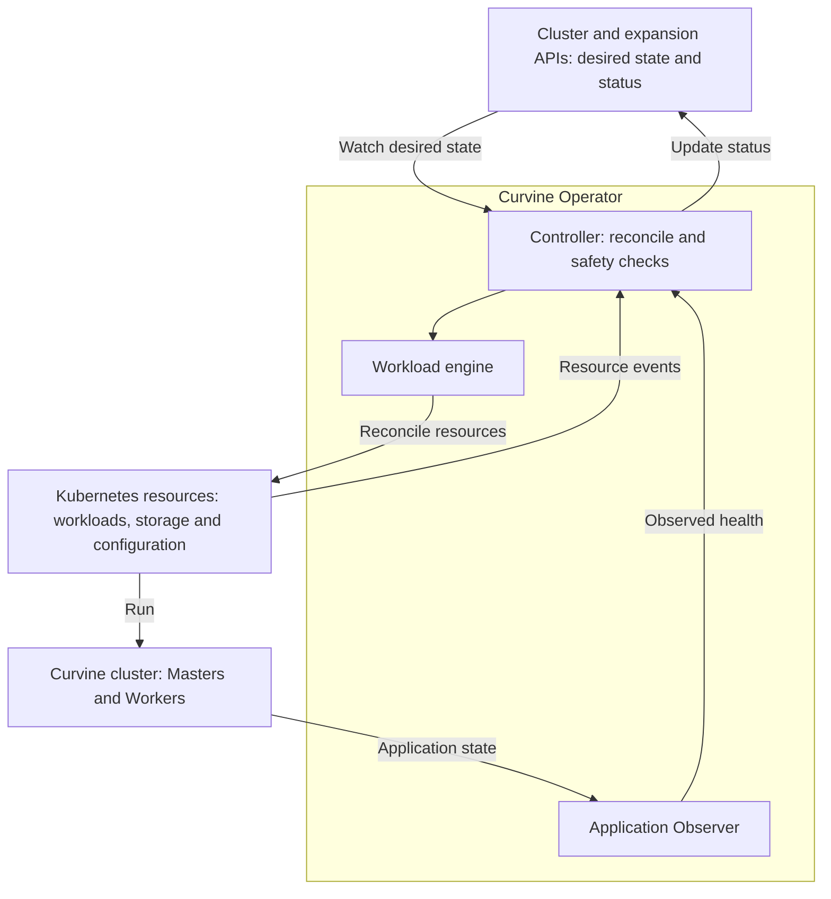

# Curvine Operator

**English** | [简体中文](README_zh.md)

Curvine Operator aims to manage the lifecycle of Curvine clusters on Kubernetes, with a focus on data safety, reliable operations, and observability.

## Architecture

The Operator uses a common control loop for Curvine clusters. Runtime contracts and capability checks specialize its behavior for different versions, storage layouts and deployment purposes, including read-cache and write-cache clusters. This is the project scope; currently supported operations remain limited by the contracts described below.



Kubernetes runs and schedules the workloads. The Operator compares desired state with Kubernetes and application observations, applies supported changes, and reports progress or blockers.

## Status

The project is an early prototype. Offline planning, a Kubernetes control plane, and opt-in workload reconciliation are implemented. A read-only HTTP Observer for Curvine v0.5.4-alpha is implemented; quorum/data-availability proof remains unavailable. Scoped Kubernetes read-cache deployment and expansion validation is documented below. An opt-in S3/OSS read-cache contract with read-only FUSE is implemented; see the scoped validation evidence below.

## Current capabilities

- Define and validate cluster specifications.
- Generate offline plans for cluster creation and worker expansion.
- Flag changes that require dedicated workflows, including scale-in, upgrades, and storage migration.
- Observe Master roles, Worker registration, heartbeat freshness and reported build provenance through a release-specific read-only Observer.
- Generate and reconcile StatefulSets, retained volume templates, Services, configuration, and disruption budgets.
- Register an immutable S3/OSS source through a Secret-backed mount Job, manage opted-in FUSE nodes, and report scoped read/cache/origin health.
- Diagnose per-pool allocation and registration progress, report stalls, and expose fresh status metrics.
- Verify expansion with continuous FUSE reads, Operator restart, and per-new-Worker I/O evidence using an explicit test-cluster tool.
- Watch managed resources, repair supported drift, and refuse conflicting ownership or unsafe replica changes.

Offline plans remain advisory. Workload management requires an explicit runtime contract. The v0.5.4-alpha HTTP contract keeps unprovable quorum and data availability Unknown. Ordinary deployments block Worker mutations without quorum evidence; read-cache deployments allow Worker allocation after Master startup while keeping destructive operations blocked.

## Roadmap

- **Cluster lifecycle:** deployment, persistent storage, health monitoring, and reconciliation.
- **Safe operations:** worker draining, controlled upgrades, and backup and recovery.
- **Integration:** metadata and transfer services, service discovery, and CSI/FUSE.
- **Optimization:** capacity planning, data preloading, and performance validation.

### Next milestone: existing-cluster integration and Worker expansion

**Worker-only integration is implemented and locally tested; live acceptance is pending.** The opt-in `CurvineWorkerExpansion` API preserves Helm ownership of the source cluster and creates a separately managed additional Worker. See the [binding, storage and runtime contract](docs/existing-worker-expansion.md). The first validation scenario is read-cache expansion from one Worker to two on separate prepared storage nodes, keeping the existing Master. This scenario is a milestone toward broader cluster support, not the scope of the Operator. A new Kubernetes node alone does not change the desired Worker count.

Implementation and acceptance:

- [x] Worker-only integration with pinned external Master/Worker identities and a retained reservation; no automatic Helm adoption.
- [x] Explicit target-node binding, required anti-affinity, and inherited reviewed tolerations/resource requests.
- [x] Reviewed multi-NVMe layout, dedicated mount/device and ownership guards, and fail-closed diagnostics; no formatting or data deletion.
- [x] Imported host-network/runtime adapter with immutable configuration snapshots, digest/protocol checks and node-IP identities; unknown release provenance stays Unknown.
- [ ] Verify 1 → 2 expansion with continuous FUSE reads, new-Worker registration and actual I/O, plus convergence after an Operator restart.

Node provisioning and disk preparation are infrastructure prerequisites. This target does not include automatic replica selection, cache rebalancing, scale-in or Master membership changes; write-cache safety gates remain unchanged.

## Project structure

```text
curvine-operator/
├── api/v1alpha1/          # Kubernetes APIs, validation and generated types
├── cmd/
│   ├── manager/          # Kubernetes controller process
│   ├── curvine-operator/ # Offline validation and planning CLI
│   ├── expansion-plan/   # Offline existing-cluster expansion renderer
│   └── cache-node/       # FUSE node probes and agent
├── internal/
│   ├── controller/       # Reconciliation and status updates
│   ├── existing/         # Worker-only import, allocation and disk guards
│   ├── workload/         # Managed-cluster resource building and execution
│   ├── curvine/          # Version/runtime-specific application adapters
│   ├── observe/          # Observation interfaces and evidence validation
│   ├── expansion/        # Managed-cluster allocation diagnostics
│   ├── telemetry/        # Operator metrics
│   ├── cachecontract/    # Read-cache configuration/report contracts
│   ├── cacheobserve/     # Read-cache health collection
│   ├── cachenode/        # Node-side FUSE and probe implementation
│   ├── plan/             # Pure change planning
│   └── cli/              # Offline CLI implementation
├── config/               # CRDs, RBAC and opt-in deployment overlays
├── helpers/              # Curvine SDK mount helper
├── scripts/              # Build preparation and consumer rendering
├── examples/             # Cluster specification examples
├── tests/                # API-server integration and explicit E2E tools
└── docs/                 # Contracts, roadmap and validation evidence
```

## Documentation

- [Existing read-cache Worker expansion](docs/existing-worker-expansion.md)

- [S3/OSS read-cache and FUSE contract](docs/read-cache.md) (Chinese)
- [Read-cache validation and remaining limits](docs/validation-read-cache.md) (Chinese)
- [Worker expansion, diagnostics and metrics](docs/worker-expansion.md) (Chinese)
- [Kubernetes expansion validation](docs/validation-expansion.md) (Chinese)
- [Offline validation and planning](docs/s0.md) (Chinese)
- [Control plane and Observer](docs/s1-control-plane.md) (Chinese)
- [Workload reconciliation](docs/s2-workloads.md) (Chinese)
- [v0.5.4-alpha application contract](docs/contracts/v0.5.4-alpha.md) (Chinese)
- [Design](docs/design.md) (Chinese)
- [Roadmap](docs/roadmap.md) (Chinese)
