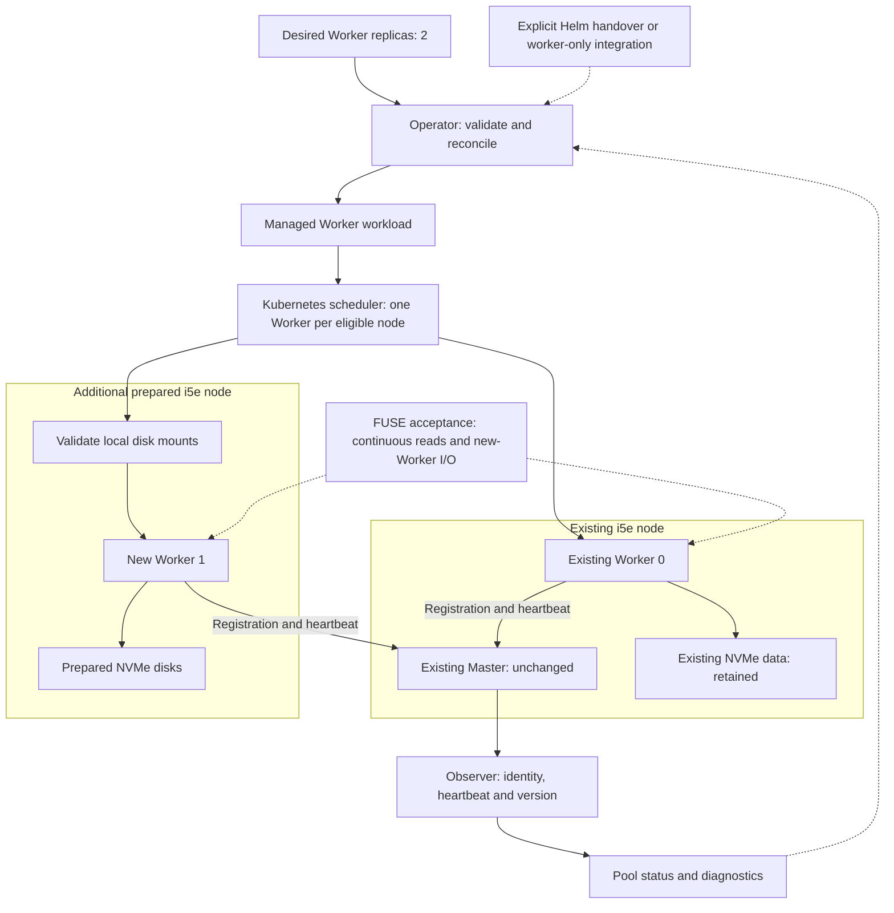

# Curvine Operator

**English** | [简体中文](README_zh.md)

Curvine Operator aims to manage the lifecycle of Curvine clusters on Kubernetes, with a focus on data safety, reliable operations, and observability.

## Status

The project is an early prototype. Offline planning, a Kubernetes control plane, and opt-in workload reconciliation are implemented. A read-only HTTP Observer for Curvine v0.5.4-alpha is implemented; quorum/data-availability proof and Kubernetes end-to-end deployment validation remain pending. An opt-in S3/OSS read-cache contract with read-only FUSE is implemented; see the scoped validation evidence below.

## Current capabilities

- Define and validate cluster specifications.
- Generate offline plans for cluster creation and worker expansion.
- Flag changes that require dedicated workflows, including scale-in, upgrades, and storage migration.
- Observe Master roles, Worker registration, heartbeat freshness and reported build provenance through a release-specific read-only Observer.
- Generate and reconcile StatefulSets, retained volume templates, Services, configuration, and disruption budgets.
- Register an immutable S3/OSS source through a Secret-backed mount Job, manage opted-in FUSE nodes, and report scoped read/cache/origin health.
- Watch managed resources, repair supported drift, and refuse conflicting ownership or unsafe replica changes.

Offline plans remain advisory. Workload management requires an explicit runtime contract. The v0.5.4-alpha HTTP contract keeps unprovable quorum and data availability Unknown. Ordinary deployments block Worker mutations without quorum evidence; read-cache deployments allow Worker allocation after Master startup while keeping destructive operations blocked.

## Roadmap

- **Cluster lifecycle:** deployment, persistent storage, health monitoring, and reconciliation.
- **Safe operations:** worker draining, controlled upgrades, and backup and recovery.
- **Integration:** metadata and transfer services, service discovery, and CSI/FUSE.
- **Optimization:** capacity planning, data preloading, and performance validation.

### Next target: expand an existing read-cache cluster from one Worker to two

**Planned; not yet supported for existing Helm deployments.** Use a second prepared i5e storage node to run an additional Worker against the existing Master, preserving the first Worker and its data. A new Kubernetes node alone does not change the desired Worker count.

Remaining work:

- [ ] Define an explicit Helm handover or worker-only integration mode, with one owner for each managed field and a reference to the existing Master.
- [ ] Add Worker node-pool selection, required anti-affinity, tolerations and resource requests so the two Workers run on separate eligible nodes.
- [ ] Support local multi-NVMe storage, mount/device validation and disk readiness diagnostics; retain existing data and never format disks automatically.
- [ ] Adapt host networking, ports, configuration paths and advertised Worker identities; validate runtime build provenance and application compatibility.
- [ ] Verify 1 → 2 expansion with continuous FUSE reads, new-Worker registration and actual I/O, plus convergence after an Operator restart.

Node provisioning and disk preparation are infrastructure prerequisites. This target does not include automatic replica selection, cache rebalancing, scale-in or Master membership changes; write-cache safety gates remain unchanged.

### Target architecture

The diagram shows the planned existing-cluster integration. The reconciliation loop already exists; Helm integration, node placement and local-disk/runtime adapters remain to be implemented.

Registration is a control-plane milestone; actual data serving is verified separately by the acceptance test.

## Documentation

- [S3/OSS read-cache and FUSE contract](docs/read-cache.md) (Chinese)
- [Read-cache validation and remaining limits](docs/validation-read-cache.md) (Chinese)
- [Offline validation and planning](docs/s0.md) (Chinese)
- [Control plane and Observer](docs/s1-control-plane.md) (Chinese)
- [Workload reconciliation](docs/s2-workloads.md) (Chinese)
- [v0.5.4-alpha application contract](docs/contracts/v0.5.4-alpha.md) (Chinese)
- [Design](docs/design.md) (Chinese)
- [Roadmap](docs/roadmap.md) (Chinese)
