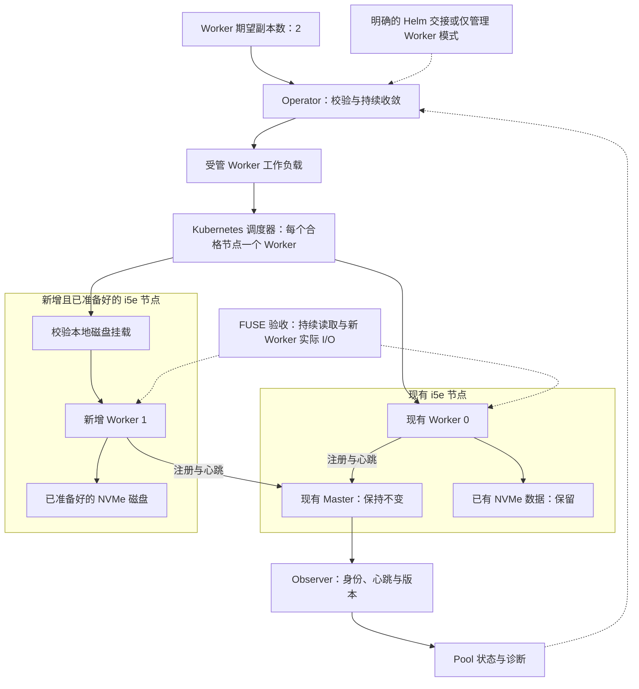

# Curvine Operator

[English](README.md) | **简体中文**

Curvine Operator 致力于管理 Kubernetes 上 Curvine 集群的完整生命周期，重点关注数据安全、可靠运维和可观测性。

## 当前状态

项目处于早期原型阶段，已实现离线规划、Kubernetes 控制面及可显式启用的工作负载收敛。已实现 Curvine v0.5.4-alpha 的只读 HTTP Observer；quorum/数据可用性证明和Kubernetes 端到端部署验收仍待完成。新增可显式启用的 S3/OSS + 只读 FUSE 缓存契约，验证范围见下方记录。

## 已有能力

- 定义并校验集群规格。
- 为集群创建和 Worker 扩容生成离线计划。
- 识别需要专门流程的变更，包括缩容、升级和存储迁移。
- 通过发布版只读 Observer 观察 Master 角色、Worker 注册、心跳新鲜度和上报的构建来源。
- 生成并收敛 StatefulSet、保留卷模板、Service、配置及中断预算。
- 通过引用 Secret 的 Mount Job 注册不可变 S3/OSS 来源，管理显式选择节点上的 FUSE，报告有探针范围的读路径、命中和来源状态。
- 监听受管资源、修复受支持的漂移，阻止所有权冲突与危险副本变更。

离线计划仅供参考。工作负载管理需显式选择运行契约；v0.5.4-alpha HTTP 契约无法证明 quorum 和数据可用性，因此这两项保持 Unknown。普通模式继续阻止缺少 quorum 证据的 Worker 变更；读缓存模式允许 Master 启动后分配 Worker，破坏性操作仍被阻断。

## 演进方向

- **集群生命周期：** 部署、持久化存储、健康观测与状态收敛。
- **安全运维：** Worker 数据排空、受控升级与备份恢复。
- **服务集成：** 元数据与传输服务、服务发现和 CSI/FUSE。
- **运行优化：** 容量规划、数据预热与性能验证。

### 下一目标：现有读缓存集群从一个 Worker 扩到两个

**规划中；尚不支持直接扩容现有 Helm 部署。** 使用第二台已准备好的 i5e 存储节点运行新增 Worker，连接现有 Master，保留第一个 Worker 及其数据。新增 Kubernetes 节点本身不会改变 Worker 的期望副本数。

待完成工作：

- [ ] 明确 Helm 交接或仅管理 Worker 的接入模式，为受管字段指定唯一管理者，并引用现有 Master。
- [ ] 增加 Worker 节点池选择、强制反亲和、容忍及资源请求，确保两个 Worker 分布在不同的合格节点。
- [ ] 支持本地多块 NVMe、挂载与设备校验、磁盘就绪诊断；保留已有数据，不自动格式化磁盘。
- [ ] 适配主机网络、端口、配置路径和 Worker 注册身份，验证运行版本来源与应用兼容性。
- [ ] 验收 1 → 2 扩容期间的持续 FUSE 读取、新 Worker 注册及实际 I/O，以及 Operator 重启后的持续收敛。

节点供应和磁盘准备属于基础设施前提。本目标不包含自动决定副本数、缓存重平衡、缩容或 Master 成员变更；写缓存安全门槛保持不变。

### 目标架构

下图表示规划中的现有集群接入。已有 reconciliation 循环可复用；Helm 接入、节点放置及本地磁盘/运行契约适配仍待实现。

注册成功属于控制面里程碑；实际数据服务能力由独立验收验证。

## 文档

- [S3/OSS 读缓存与 FUSE 契约](docs/read-cache.md)
- [读缓存验证与当前限制](docs/validation-read-cache.md)
- [离线校验与变更规划](docs/s0.md)
- [控制面与 Observer](docs/s1-control-plane.md)
- [工作负载收敛](docs/s2-workloads.md)
- [v0.5.4-alpha 应用契约](docs/contracts/v0.5.4-alpha.md)
- [能力设计](docs/design.md)
- [实施路线](docs/roadmap.md)
