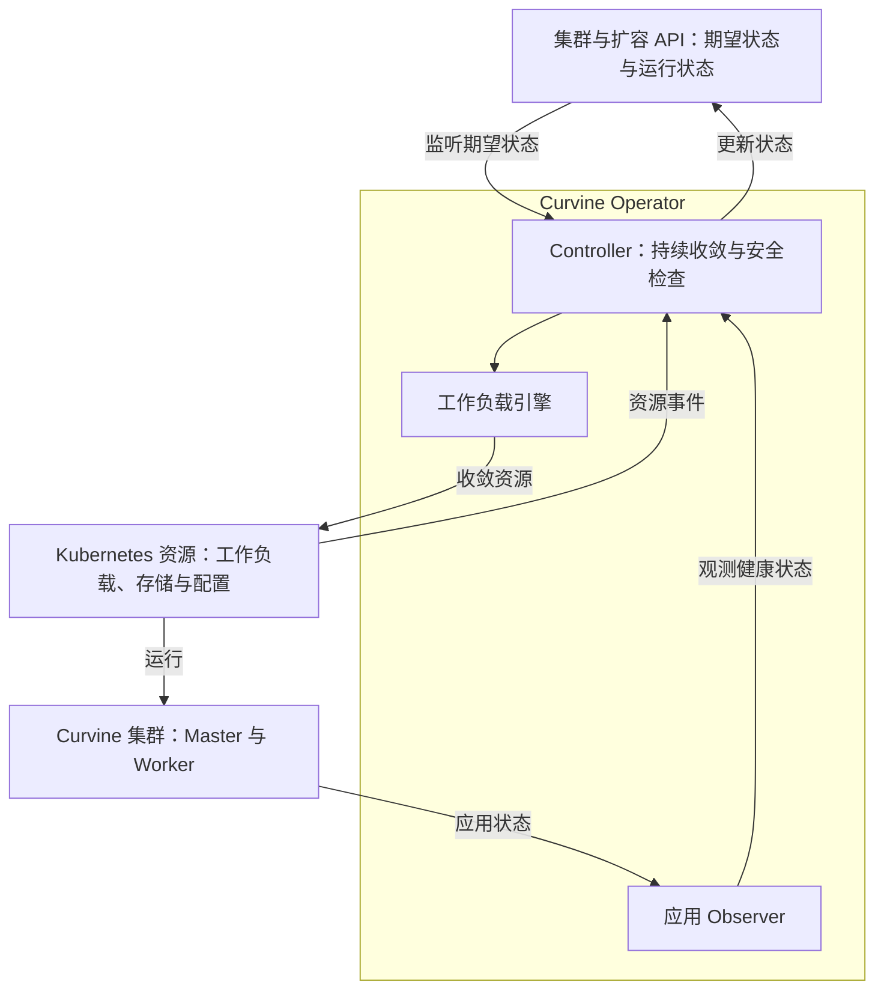

# Curvine Operator

[English](README.md) | **简体中文**

Curvine Operator 致力于管理 Kubernetes 上 Curvine 集群的完整生命周期，重点关注数据安全、可靠运维和可观测性。

## 核心架构

Operator 使用统一的控制循环管理 Curvine 集群，通过运行契约和能力检查适配不同版本、存储布局及部署用途，包括读缓存和写缓存集群。这是项目的目标范围；当前可执行的操作仍受下文所述契约约束。



Kubernetes 负责运行和调度工作负载。Operator 对比期望状态与 Kubernetes、应用层观测，执行受支持的变更，并报告进度或阻塞原因。

## 当前状态

项目处于早期原型阶段，已实现离线规划、Kubernetes 控制面及可显式启用的工作负载收敛。已实现 Curvine v0.5.4-alpha 的只读 HTTP Observer；quorum/数据可用性证明仍缺失。已补充有明确范围的 Kubernetes 读缓存部署与扩容验收，详见验证记录。新增可显式启用的 S3/OSS + 只读 FUSE 缓存契约，验证范围见下方记录。

## 已有能力

- 定义并校验集群规格。
- 为集群创建和 Worker 扩容生成离线计划。
- 识别需要专门流程的变更，包括缩容、升级和存储迁移。
- 通过发布版只读 Observer 观察 Master 角色、Worker 注册、心跳新鲜度和上报的构建来源。
- 生成并收敛 StatefulSet、保留卷模板、Service、配置及中断预算。
- 通过引用 Secret 的 Mount Job 注册不可变 S3/OSS 来源，管理显式选择节点上的 FUSE，报告有探针范围的读路径、命中和来源状态。
- 按 Worker pool 诊断资源分配与注册进度、报告停滞，并输出有效状态指标。
- 用显式测试集群工具验证扩容期间 FUSE 读取、Operator 重启和新增 Worker 实际 I/O。
- 监听受管资源、修复受支持的漂移，阻止所有权冲突与危险副本变更。

离线计划仅供参考。工作负载管理需显式选择运行契约；v0.5.4-alpha HTTP 契约无法证明 quorum 和数据可用性，因此这两项保持 Unknown。普通模式继续阻止缺少 quorum 证据的 Worker 变更；读缓存模式允许 Master 启动后分配 Worker，破坏性操作仍被阻断。

## 演进方向

- **集群生命周期：** 部署、持久化存储、健康观测与状态收敛。
- **安全运维：** Worker 数据排空、受控升级与备份恢复。
- **服务集成：** 元数据与传输服务、服务发现和 CSI/FUSE。
- **运行优化：** 容量规划、数据预热与性能验证。

### 下一里程碑：现有集群接入与 Worker 扩容

**仅管理新增 Worker 的接入已实现并通过本地测试；真实集群验收待执行。** 显式启用的 `CurvineWorkerExpansion` API 保留原集群的 Helm 所有权，创建独立受管的新增 Worker。详见[绑定、存储和运行契约](docs/existing-worker-expansion.md)。首个验收场景是在不同的已准备存储节点上将读缓存 Worker 从一个扩到两个，保持现有 Master 不变。该场景是面向更广泛集群支持的阶段性里程碑，不限定 Operator 的目标范围。新增 Kubernetes 节点本身不会改变 Worker 的期望副本数。

实现与验收：

- [x] 仅管理新增 Worker，固定外部 Master/Worker 身份并保留扩容预约；不自动接管 Helm。
- [x] 显式绑定目标节点、强制反亲和，并继承已审核的容忍与资源请求。
- [x] 继承已审核的多 NVMe 布局，增加独立挂载、设备与磁盘归属检查；不格式化或删除数据。
- [x] 适配现有主机网络、不可变配置快照、镜像摘要/协议和节点 IP 身份；未知发布来源保持 Unknown。
- [ ] 验收 1 → 2 扩容期间的持续 FUSE 读取、新 Worker 注册及实际 I/O，以及 Operator 重启后的持续收敛。

节点供应和磁盘准备属于基础设施前提。本目标不包含自动决定副本数、缓存重平衡、缩容或 Master 成员变更；写缓存安全门槛保持不变。

## 项目目录

```text
curvine-operator/
├── api/v1alpha1/          # Kubernetes API、校验与生成类型
├── cmd/
│   ├── manager/          # Kubernetes 控制器进程
│   ├── curvine-operator/ # 离线校验与规划 CLI
│   ├── expansion-plan/   # 现有集群扩容离线渲染器
│   └── cache-node/       # FUSE 节点探针与代理
├── internal/
│   ├── controller/       # 持续收敛与状态更新
│   ├── existing/         # 新增 Worker 接入、分配与磁盘检查
│   ├── workload/         # 受管集群资源构建与执行
│   ├── curvine/          # 版本及运行契约适配
│   ├── observe/          # 观测接口与证据校验
│   ├── expansion/        # 受管集群分配诊断
│   ├── telemetry/        # Operator 指标
│   ├── cachecontract/    # 读缓存配置及报告契约
│   ├── cacheobserve/     # 读缓存健康采集
│   ├── cachenode/        # 节点 FUSE 与探针实现
│   ├── plan/             # 纯函数变更规划
│   └── cli/              # 离线 CLI 实现
├── config/               # CRD、RBAC 与可选部署配置
├── helpers/              # Curvine SDK 挂载辅助程序
├── scripts/              # 构建准备与业务 Pod 渲染
├── examples/             # 集群规格示例
├── tests/                # 隔离 API Server 集成测试与显式 E2E 工具
└── docs/                 # 契约、路线图与验证记录
```

## 文档

- [现有读缓存 Worker 扩容](docs/existing-worker-expansion.md)

- [S3/OSS 读缓存与 FUSE 契约](docs/read-cache.md)
- [读缓存验证与当前限制](docs/validation-read-cache.md)
- [Worker 扩容、诊断与指标](docs/worker-expansion.md)
- [Kubernetes 扩容验证](docs/validation-expansion.md)
- [离线校验与变更规划](docs/s0.md)
- [控制面与 Observer](docs/s1-control-plane.md)
- [工作负载收敛](docs/s2-workloads.md)
- [v0.5.4-alpha 应用契约](docs/contracts/v0.5.4-alpha.md)
- [能力设计](docs/design.md)
- [实施路线](docs/roadmap.md)
