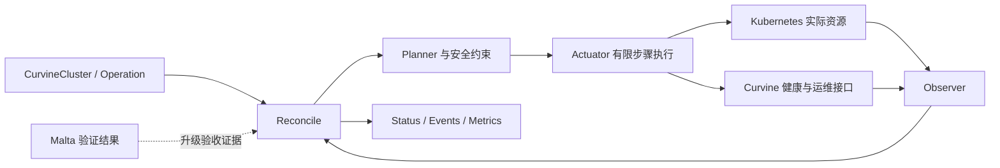

# Curvine Operator 能力设计

状态：设计草案，2026-10-28。除 README 中标注的 S0 能力，其余均为待实现设计。

## 1. 产品边界

Operator 负责 Curvine 服务的安装、期望状态收敛、配置、扩缩容、升级、恢复和运行诊断。Kubernetes 负责 Pod 调度与重启，Curvine 负责 Raft、数据复制、元数据一致性和数据路径，CSI 负责卷发布与节点挂载。Operator 调用这些能力并验证结果，不在控制器中重写存储协议。

集群级生命周期先闭环，再增加数据集预热、自动调优和 UI。第一版不把所有配置项都暴露成任意 TOML 字符串：集群身份、Raft 地址、格式化标志、存储路径和凭据归 Operator 管理；后续高级配置使用版本化白名单与冲突检查。

## 2. 架构与职责

建议使用 Go + controller-runtime，统一 Kubernetes 类型、缓存、watch、工作队列与 leader election。S0 没有引入此依赖；接入时按其官方兼容关系选择成套的 `k8s.io/*` 版本，并明确实际支持的 Kubernetes 集群版本，不能把编译依赖版本当成 E2E 兼容矩阵。

每次 reconcile 只推进有限步骤；调用外部接口设超时，失败使用退避。不在一个 reconcile 中长时间等待备份、drain 或压测。以集群 UID、目标 generation、操作 UID 和步骤 ID 做去重，恢复时先观察已有结果再继续。不同集群可并发，同一集群的升级、缩容与恢复互斥。leader election 不替代幂等性。

现有同名资源的 owner UID 不匹配时，报告冲突并停止，不自动接管。管理字段采用明确 field ownership，避免覆盖用户维护的标签。删除和重建同名 CR 时，保留卷不得因名称相同就自动成为新集群数据；需要卷标记与显式导入流程。

## 3. API 划分

| API | 主要意图 | 生命周期边界 |
| --- | --- | --- |
| `CurvineCluster` | 版本、Master、Worker pools、存储、网络、可选 MDS/Transfer、外部依赖 | 长期存在，status 反映观察状态 |
| `CurvineOperation`（P1） | 升级、drain、受控扩缩容、迁移、诊断 | 可恢复步骤、目标 generation、超时与结果引用 |
| `CurvineBackup` / `CurvineRestore`（P1） | 备份目标、恢复源、校验与恢复目标 | 有保留策略及审计的独立任务 |
| 数据集预热资源（P3，名称待定） | UFS 引用、路径、TTL、容量预算与优先级 | 先复用 Transfer/Fluid 能力，再决定是否单独建 CRD |

不要一开始创建大量 CRD。S1 只注册 `CurvineCluster`；Operation 与备份 API 在有可用执行协议之后引入。S0 JSON 模型尚不是 Kubernetes runtime.Object，不支持服务端默认值、CEL、admission 或 status subresource。

期望 status 至少包含 `observedGeneration`、实际版本分布、Master leader/成员/仲裁、Worker 注册数/容量/退役状态、配置哈希、端点、正在执行的操作与 Conditions。Conditions 建议分开使用 `SpecValid`、`ResourcesReady`、`QuorumHealthy`、`DataAvailable`、`Progressing`、`Degraded`；观察失败标 `Unknown` 并保留时间，不能把无数据当健康。

所有 Condition 带 reason、message、lastTransitionTime 和 observedGeneration。`observedGeneration` 表示已处理该代规格，不表示执行成功；Ready 必须基于该代配置、应用健康及必要的读写探针。Pod Ready 数量只是其中一个输入。

## 4. 部署与存储模型

**Master：** 使用 StatefulSet、headless Service、稳定 ordinal 和独立持久卷。生成完整的 Pod DNS：`<cluster>-master-<n>.<cluster>-master.<namespace>.svc.<domain>`；Raft 节点 ID 与 ordinal 的映射一旦创建固定。metadata 与 journal 至少使用 PVC 明确持久化，后续评估分盘。绝不通过容器重启自动打开 `format_master`。

3/5 节点按 Kubernetes 节点强制反亲和，按可用区设置拓扑策略；资源不足时保持 Pending 并解释原因，不能静默弱化到单故障域。单 Master 只用于开发。PDB 根据仲裁配置，并说明它只约束自愿驱逐，不能阻止所有控制器滚动更新和主机故障。

**Worker：** 先以具备稳定身份与 PVC 的 Worker pool 为可控基线。Local PV 的节点约束、磁盘格式和可重建性需要专门诊断；PVC 并不意味着数据天然能迁到另一节点。后续支持 DaemonSet + 本地磁盘模式，显式声明 hostPath、盘类型、保留空间、节点选择和盘损坏行为。禁止默认扫描、格式化或清空宿主磁盘。

多存储介质和多 Worker 池分别表达存储级别、容量、resources、nodeSelector、tolerations 与 topology。GPU 训练节点上的缓存需设置明确资源预算；控制器不假设所有工作负载都应使用 hostNetwork 或 privileged。RDMA/SPDK 在设备插件、hugepages、NUMA 和权限前置条件验收后单独支持。

删除策略第一版只允许 Retain。删除 CR 可移除服务资源，但元数据和 Worker 数据卷不能随 ownerReference 被误删。Finalizer 只用于必须完成的协调工作，不能因 Curvine 不可达永久阻塞删除；明确保留资源清单、人工恢复方法与孤儿资源标记。

## 5. 高风险操作的状态机

### Worker 缩容

`Preflight → SelectWorker → MarkDecommission → WaitEvacuation → VerifySafeToRemove → RemovePod → VerifyCluster → Complete`

必须区分可从 UFS 重建的缓存、已确认持久化的数据和仍有唯一/脏副本的数据。核心判据至少包括：停止新分配、在途写入处理、目标节点剩余必需数据、全局副本约束、UFS 持久化状态和其余容量。仅调用 add-dcm 成功或看到某个总量指标为 0 不足以删除节点。缺少接口或证据时保持 Blocked。

缩容目标要与 StatefulSet 删除 ordinal 的实际行为一致。取消退役只能在尚未删除节点且业务状态允许时调用 remove-dcm；删除后不能把“取消操作”伪装成恢复数据。S0 对缩容和池删除一律返回 `WorkerDrainRequired`。

### Master 扩缩容与升级

Master 成员变更必须使用 Curvine 的 Raft 协议，单成员逐步变更、校验追赶与仲裁，再修改运行资源；不能同时改配置成员列表与 replicas 并期待自动收敛。第一版固定创建时副本数，后续先核验现有 ConfChange 接口及失败恢复语义。

升级前固定镜像 digest 和源/目标版本能力，检查元数据格式与降级兼容性，保存恢复点。Master 先处理 follower，保持多数派；leader 迁移接口未验证前不能假设可自动转移。Worker 逐节点或按已验证预算 drain 后升级。失败暂停、保留证据，禁止循环重启或无条件退回旧镜像。PDB 不能代替应用级升级状态机。

配置先分类：动态可重载、需滚动重启、需迁移、不可变。生成不可变的配置版本，以哈希绑定 Pod revision；保留仍被运行 Pod 使用的配置。计划里同时包含不支持的迁移和安全扩容时，第一版整体阻断，防止半执行。

### 备份与恢复

Raft 内部 snapshot 不自动等同于可跨集群恢复的外部备份。明确元数据快照、journal 一致性点、数据副本/UFS 的覆盖范围，记录版本、clusterID、校验和、加密与对象存储引用。优先恢复到新集群，经过 metadata 和实际文件读写校验后再切换使用方；定期演练并测量 RPO/RTO。

## 6. 扩展服务与集成

| 能力 | 建议管理方式 | 上线前需明确 |
| --- | --- | --- |
| MDS | 单独 Deployment 与配置版本；引用外部 FDB cluster file | 路由关系、FDB 可用性、事务健康、镜像动态库；禁止生产 memory backend |
| FoundationDB | 初期只引用已有 FDB，不接管其集群生命周期 | 凭据/cluster file 注入、网络、支持版本与备份归属 |
| Transfer | 独立服务，按状态后端设计副本与恢复 | SQLite/外部数据库选择、lease、幂等任务、重启恢复；不得假定完全无状态 |
| Discovery | 外部 etcd 引用，健康和过期数据监控 | 当前源码阶段的认证/TLS 边界、失联缓存策略、服务注册租约 |
| CSI/FUSE | 版本兼容矩阵与安装集成，复用已有驱动 | CSIDriver 等集群级资源单一所有者；卷发布/挂载状态仍由 CSI 管理 |
| Fluid | 显式 standalone / Fluid 管理模式 | 同一 StatefulSet、配置和缓存任务不能被两个控制器同时收敛 |
| Malta | 把集群版本、镜像 digest、环境与配置快照交给 Malta 测试 | Operator 管生命周期，Malta 管基准；统一结果引用，不复制压测引擎 |

Malta 先用于预发布环境的部署后读写 smoke 和升级前后对照；固定环境、数据集与资源隔离才能判断回归。其结果是验收证据，不能用 benchmark 成功替代数据完整性校验，也不应在每次 reconcile 中自动运行压力测试。

## 7. 可观测性、安全与自助诊断

同时观察控制器和存储服务：reconcile 错误/延迟、操作阶段耗时、Raft leader/term/lag、Worker 容量与保留空间、欠副本、drain 进度、UFS 错误、CSI 挂载失败。应用指标名以源码及运行端点核验为准，不在设计中假造现有指标。

ServiceMonitor 作为可选集成，不能假定用户安装 Prometheus Operator。提供 Pending/Blocked 原因、关键 Kubernetes Events、版本/配置差异和脱敏诊断包。凭据使用 Secret 引用，状态、日志和 ConfigMap 不存储访问密钥。

RBAC 按职责缩小，控制器默认不读取无关 Secret，区分集群管理员安装权限与租户创建 CR 权限。增加 NetworkPolicy、镜像拉取配置及传输认证的支持矩阵；Curvine 上游尚未提供的安全能力应列为依赖，不能由 Operator 宣称已经补齐。

## 8. 最值得先做的三件事

1. **应用级 Observer 与运维接口契约。** 能准确判断仲裁、Worker 注册和可安全删除状态，才有资格自动操作。
2. **可恢复的操作记录。** 长操作中控制器重启、leader 切换或请求重试都不能重复破坏性步骤。
3. **真实故障注入与恢复验收。** 与 Malta 的性能验收分开，覆盖断网、磁盘故障、在途写入、仲裁丢失和不完整备份。

设计依据：[Kubernetes Operator 模式](https://kubernetes.io/docs/concepts/extend-kubernetes/operator/)、[StatefulSet 存储与更新语义](https://kubernetes.io/docs/concepts/workloads/controllers/statefulset/)、[controller-runtime 版本兼容规则](https://github.com/kubernetes-sigs/controller-runtime/blob/main/VERSIONING.md)。Curvine 具体依据见 [源码核查](source-audit.md)。
