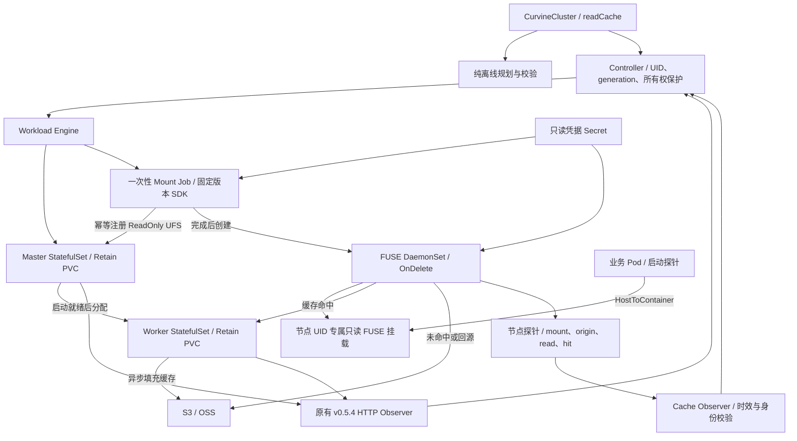

# S3/OSS + FUSE 只读缓存

首期以 Curvine **v0.5.4-alpha**、源码 commit `89df141912e96d127421de6e4d36e6e2190d9949` 为契约。S3/OSS 是数据源，Curvine 缓存可重建；业务通过只读 FUSE 读取。只接受不可变、版本化数据集，不承诺同名对象覆盖后立即可见，也不自动检测所有对象变化。当前实现、验证范围和未完成项见 [验证记录](validation-read-cache.md)。

## 从规格到读路径



`spec.readCache` 是创建时选择的不可变用途。已有普通集群不能原地开启；来源、Secret 引用、TTL、探针等配置也不能原地修改。普通模式的原有保护保持有效。示例：[cluster-read-cache.json](../examples/cluster-read-cache.json)。

- `backend`：`S3` 或 `OSS`，分别使用 `s3://`、`oss://` 来源 URI。
- `source`：bucket 或不可变数据集前缀；不得带凭据、查询参数或路径穿越。建议使用独立版本前缀。
- `endpoint`：不带路径的 HTTP(S) origin；生产使用对应存储的 HTTPS endpoint。
- `region`：存储区域。S3 使用 path-style 请求；具体服务支持情况需要验收。
- `credentialsSecret`：同 namespace Secret 名称，包含 `accessKey`、`secretKey`。当前不支持临时 STS token 或 IAM role 自动刷新。
- `consistency: Immutable`：禁止依赖源对象原地覆盖；应用应选择新数据集版本。
- `ttlSeconds`：60～2592000，传给 UFS mount 的缓存 TTL；不是主动一致性刷新周期。
- `minFreePercent`：10～50，传给 Worker `free_ratio` 保留空闲空间。不是容量配额或完整淘汰策略。
- `readConcurrency`：1～16，每个 OpenDAL reader 的并行度。不是集群级限流；异步填充队列 32、提交并发 2。容量压力、总回源带宽和驱逐行为仍需压测。
- `probe`：前缀下固定、非敏感小对象的相对路径、SHA256、精确字节数（最多 16 MiB）。初始化和每个 FUSE 节点均验证该对象；证据只覆盖这个对象及节点。

## 镜像与凭据边界

普通上游镜像不含本次新增 helper。使用仓库根目录的 `Dockerfile.readcache` 构建组合镜像，将发布后的真实 digest 填入 `spec.image`：

```sh
docker build -f Dockerfile.readcache -t YOUR_REGISTRY/curvine-read-cache:VERSION .
```

镜像包含固定源码构建的 server、FUSE、SDK mount helper 和 Go node agent；不能用示例中的占位 digest 部署。源码固定不等于基础镜像和系统依赖完全可复现；发行前需要构建扫描与记录镜像 digest。

由集群管理员预先创建只读来源 Secret。**Operator ServiceAccount 无 Secret 读取权限**，仅由 kubelet 投射到 Mount Job/FUSE Pod；业务 Pod 不接收该 Secret。helper 从文件读取凭据，不把值拼入 argv、环境变量、ConfigMap 或 Operator status，不输出 SDK 原始错误。凭据应在存储服务端限制为该 bucket/prefix 的读取与必要的列举权限，不能授予写入/删除。

Curvine 上游会通过 RPC 接收并在 Master 挂载元数据中保存这些 properties，其中包含凭据。这不是端到端加密或上游鉴权增强；须保护 Master 元数据、RPC 网络和其诊断日志。当前不支持安全自动轮换：原 Secret 内容变化会导致挂载校验冲突，Operator 不会覆盖注册或强制卸载，应走独立迁移流程。FUSE `ro` 也不限制绕过它的原始 Curvine RPC 客户端；集群按专用读缓存用途部署并限制网络访问。

## 启动和业务接入

Manager 显式使用 `--workload-contract=curvine-v0.5.4-alpha`。先创建 Secret、选择 Linux 节点并显式设置 `storage.curvine.io/fuse=enabled`，再创建读缓存 CR。节点需要 `/dev/fuse`，容器运行时需要支持双向 mount propagation；命名空间准入策略需允许这个特权 DaemonSet。DaemonSet 不是 CSI，不自动给任意 Pod 注入挂载。

顺序为配置/Service → Master 启动 → Worker 分配 → Mount Job 校验来源并幂等注册 → FUSE。Job 有 300 秒期限与最多 3 次重试，不更新已有注册，不处理不属于该 CR 的挂载，不删除完成结果。失败时显示固定原因，避免泄露凭据；修复后重建失败 Job 属于人工操作。

每个节点只在 `/var/lib/curvine-fuse/<CR UID>/data` 暴露该集群数据。业务 Pod 挂载其父目录，使用 `HostToContainer` 和 `readOnly: true` 接收子挂载；仅绑定父目录而没有传播设置是不够的。需等待 FUSE 就绪后再创建业务 Pod。可用渲染工具从**实际存活 CR 和其受管 ConfigMap**产生接入示例：

```sh
# 将实际 CR 与带 cache.json 的受管 ConfigMap 保存为本地 JSON。
# 文件仅用于渲染；命令不会创建或修改 Kubernetes 对象。
python3 scripts/render-fuse-consumer.py \
  --cluster cluster-live.json --configmap configmap-live.json \
  --image YOUR_APP_IMAGE@sha256:YOUR_REAL_DIGEST \
  --command-json '["/your/program","--input","/var/lib/curvine-export/data"]' \
  > consumer.json
```

工具校验 ConfigMap 所有权和用途，生成不含来源凭据的 Pod。init container 通过 node agent 校验 `/proc/self/mountinfo` 中确实存在只读 FUSE 挂载，并比对探针摘要。未挂载、传播失败或内容错误时业务不启动；示例 Pod 的 `restartPolicy: Never` 会让失败可见，需要在修复后重新创建。生产控制器、资源配额、调度容错策略由业务定义。

FUSE 更新为 `OnDelete`，避免自动滚动挂载；启动遇到旧挂载直接失败，不强制卸载。在删除 CR、FUSE Pod 或更改节点标签前，须停止相关业务、确认无消费者，再按节点维护流程卸载。当前没有 CSI 式生命周期协调或自动清理残留挂载。

## 健康语义与操作门槛

| Condition | 含义 |
| --- | --- |
| OriginMountReady | 所有目标节点核对到唯一、同 UID/config hash 的只读注册 |
| OriginReachable | 每个目标节点可从来源直接读取探针并验证长度与摘要 |
| ReadPathVerified | 每个目标节点的真实只读 FUSE 读路径通过该探针 |
| CacheReady | 探针读成功且其采样窗口出现命中计数与足够的 Curvine 实读字节增长；无证据为 Unknown |
| Ready | 受管资源就绪、注册正确且 FUSE 探针通过；范围仅为配置探针 |
| Degraded | 可以读取，但来源失败或缺少命中证据；或挂载/读取明确失败 |
| QuorumHealthy / DataAvailable | 保留原应用 Observer 语义；HTTP 接口缺少证明时仍为 Unknown |

节点报告绑定 CR UID、策略 hash、采样时间，超过 90 秒或节点不齐时返回 Unknown。probe HTTP 为集群内明文接口，证据依赖受管 Pod 与可信网络，非加密证明。仅 hit 计数会把打开缓存后实际回源的情况包含在内；因此同时要求 `client_read_bytes` 增长至少一个探针长度。命中与字节计数覆盖同节点的读流量，存在并发业务时不能把增长归因于某一个文件。OriginReachable 失败与 ReadPathVerified 成功可以同时出现，这表示已有缓存仍可读，**不代表未缓存对象可用**。每轮回源探针会消耗最多 `probe.sizeBytes` 字节，选小文件并考虑节点数。

读缓存模式允许 Master 工作负载启动后创建/增加 Worker；这仅放开资源分配，不声称 Raft quorum 已被证明。缩容、Worker 移除、升级、存储迁移和 Master 成员变更仍阻断。TTL 和空闲空间配置不是自动扩缩容；删除缓存、故障恢复和集群限流需要后续运维契约。
