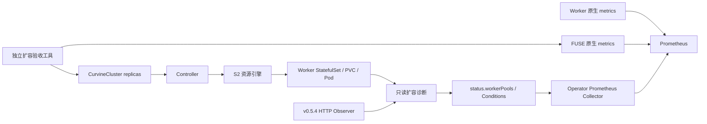

# Worker 扩容诊断与验收

本阶段覆盖读缓存的非破坏性扩容、进度诊断和指标。沿用现有 `spec.workerPools[].replicas`：增加副本仍由 S2 资源引擎执行，不引入新的操作 CR 或第二套扩容执行器。普通模式的 quorum 门槛、缩容/升级/存储变更保护不变。

## 状态与架构



每个 pool 的 `status.workerPools` 包含 desired、created、scheduled、ready、volumesBound、registered、phase、reason、resource、observedGeneration、lastProgressTime、stalled。`registered` 缺失表示无有效应用证据，不能当作 0。`allocationSampleTime` 标记本轮资源观测时间；应用观测继续使用 `observation.sampleTime`。

| phase | 含义 / 常见 reason |
| --- | --- |
| WaitingForResources | StatefulSetMissing / StatefulSetNotConverged |
| WaitingForScheduling | PodUnscheduled；先显示调度障碍，避免将 WaitForFirstConsumer 卷误判为独立存储故障 |
| WaitingForVolumes | VolumeNotBound，指出首个尚未绑定的 PVC |
| WaitingForPods | PodNotCreated / PodNotReady / ImagePullFailed / ContainerCrashLoop / ContainerConfigurationFailed |
| WaitingForRegistration | ApplicationEvidenceUnavailable / WorkerRegistrationIncomplete / WorkerHeartbeatStale / WorkerVersionUnverified / ApplicationHealthUnverified |
| Registered | 资源收敛，注册数、有效心跳与版本证据满足目标；不证明该 Worker 已承载业务 I/O |
| Blocked | 资源执行器拒绝或 StatefulSet/Pod 身份冲突；沿用具体拒绝原因 |
| Unknown | InventoryUnavailable；读取 Kubernetes 资源失败，不能判断为健康 |

诊断核对资源所有者及集群 UID，写 status 前重新核对 CR UID/generation。只记录受控原因码与对象名称，不复制 Kubernetes Event、容器错误详情或日志。

`WorkerPoolsReady` 表示所有 pool 资源与应用注册就绪。`ExpansionStalled=True` 表示至少一个未完成 pool 连续十分钟没有数量/意图变化；时间保存在 status，Operator 重启不会重置同一进度的计时。仅原因文字变化不会重置计时。诊断覆盖初次创建与扩容，完成注册后不报停滞。超时只报告问题并继续 reconcile，不自动回滚、副本递减或删除数据。

## 运行指标

`config/monitoring` 是可选 Kustomize overlay：继承 workloads，增加 Operator `:8080` 监听与集群内 Service。overlay 已选择 v0.5.4-alpha 运行契约，安装时仍需像原 workloads 配置一样指定实际 Operator 镜像。默认 manager 的 loopback 监听保持不变。

- `curvine_operator_worker_pool_replicas{state=desired|created|scheduled|ready|volumes_bound}`：资源分配进度；Unknown/Blocked 不发布观测数量。
- `curvine_operator_worker_pool_phase`、`curvine_operator_worker_pool_stalled`：当前阶段与停滞。
- `curvine_operator_worker_pool_registered`、`curvine_operator_application_sample_timestamp_seconds`：有效应用样本。
- `curvine_operator_inventory_available`：Collector 能否读取 informer inventory。

Collector 在抓取时读取缓存，不无限累积标签。删除集群、generation 不匹配及过期样本不继续输出旧数量；默认有效期 90 秒，与 manager 的 max-observation-age 一致。缺失指标不是零值。Operator 停止时还应使用 Prometheus 自带 `up` 告警。

将 `config/monitoring/prometheus-scrape.yaml` 合并到已有 Prometheus 配置，并将 `recording-rules.yaml` 加入其 rule_files。这两个文件是配置片段，不是 Kubernetes 对象。按实际 namespace 调整 discovery；scraper 需要该 namespace 的 Pods get/list/watch 与目标端口网络访问。这里没有给 Operator 增加任何 Secret 或集群级权限。指标端点供受控集群内网络使用。

原生指标提供 Worker 容量、可用空间、fs_used、读写吞吐与 FUSE 延迟。`worker_capacity_unavailable_ratio` 包含保留空间，不能等同于缓存数据占比。FUSE `client_read_bytes` 提供真实缓存读取字节；上游 hit counter 只是选择缓存 reader，不能独立证明命中。`path_type=fallback` 表示 reader 支持 fallback，可能最终读缓存或来源。因此 direct_ufs 指标只是直接 UFS 读取的下界，**本阶段不宣称精确命中率或完整回源吞吐**；完整回源量需来源端指标或上游 reader 内部计量。

## 扩容验收工具

`tests/e2e/kubernetes_scale_out.py` 对用户显式指定的测试集群执行一次扩容，不创建或修改来源对象。需要：

1. 已健康运行的 read-cache CR，ResourcesReady、WorkersHealthy、ReadPathVerified 对应当前 generation。
2. 通过 `scripts/render-fuse-consumer.py` 生成并运行的业务 Pod，应用镜像含 Python 3。不需要把 Secret 或 cache.json 挂到业务容器。
3. 已存在且未在本集群缓存过的不可变来源对象，提供相对路径、sizeBytes、sha256 的 JSON 数组。建议至少几十个不同对象，让新增 Worker 获得数据；单对象不保证分布到每个 Worker。
4. 验收者拥有读取 CR/Pods、patch 该 CR、pods/exec、pods/proxy 权限；选用重启测试时另需 patch 对应 Deployment。权限属于运行验收的人，不加入 Operator RBAC。

示例 manifest（摘要必须替换为真实内容的 SHA256）：

```json
[{"path":"version/part-0001","sizeBytes":1024,"sha256":"aaaaaaaaaaaaaaaaaaaaaaaaaaaaaaaaaaaaaaaaaaaaaaaaaaaaaaaaaaaaaaaa"}]
```

```sh
python3 tests/e2e/kubernetes_scale_out.py \
  --kubeconfig /path/to/test.kubeconfig --context dedicated-test \
  --namespace curvine-system --cluster read-cache --pool ssd \
  --consumer read-cache-consumer --manifest /path/to/cold-objects.json \
  --replicas 3 --restart-operator curvine-operator \
  --output /tmp/scale-out-result.json
```

工具在修改前重新读取 CR，并通过 JSON Patch UID/resourceVersion 测试防止覆盖并发修改。扩容后继续检查 UID/generation。它每轮校验业务容器中的真实只读 FUSE mount、探针长度与 SHA256；待新 Worker 注册后读取冷对象，并从每个新增 Worker 的 `/metrics` 核验 read_bytes、write_bytes 增长。只读探针约每秒执行一次，是采样连续性验证，不是零中断 SLA。

对象数量限制 256、单对象 16 MiB、每轮总量 64 MiB。失败报告只保留受控原因，不附 kubectl stderr、Secret 或原始日志。失败后保留扩容目标和资源供排查，不自动缩容。退出码 0 表示全部条件满足，1 表示未通过。

本地结果及边界见 [Kubernetes 扩容验证](validation-expansion.md)。后续的自动扩容策略、缓存预热、全局回源限速、受控缩容和 FUSE/节点重启恢复仍需各自实现与验收。
